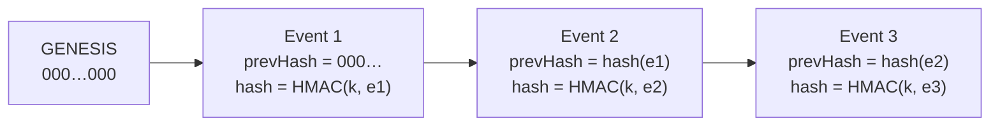
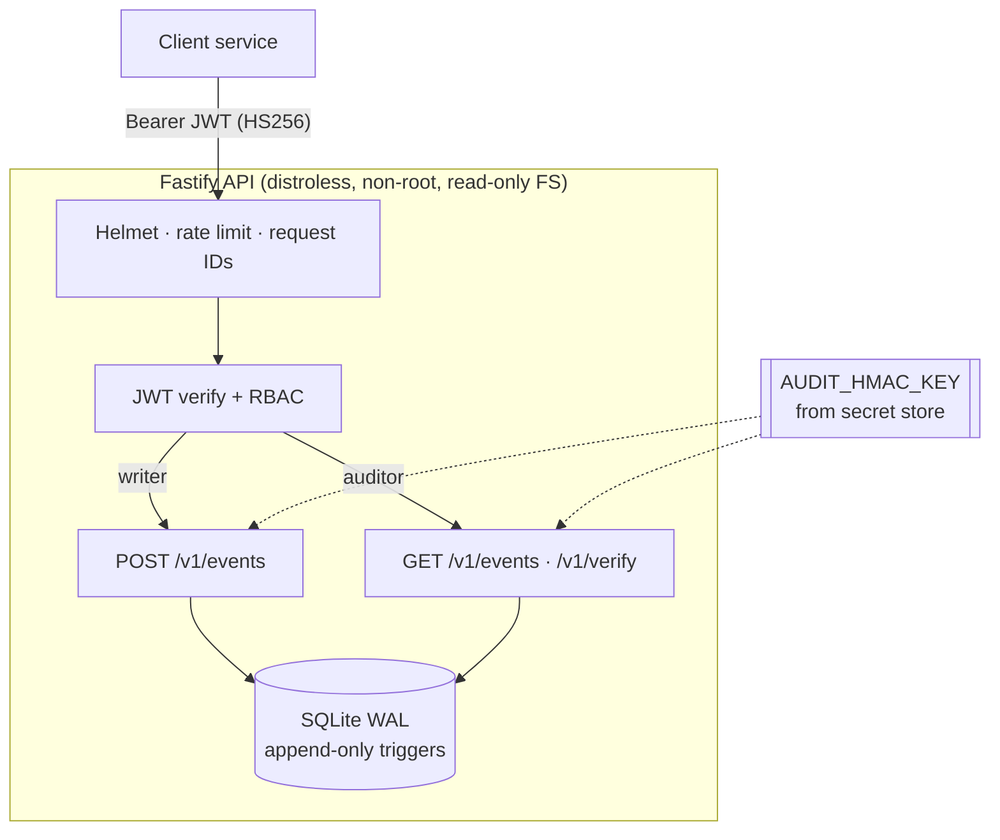
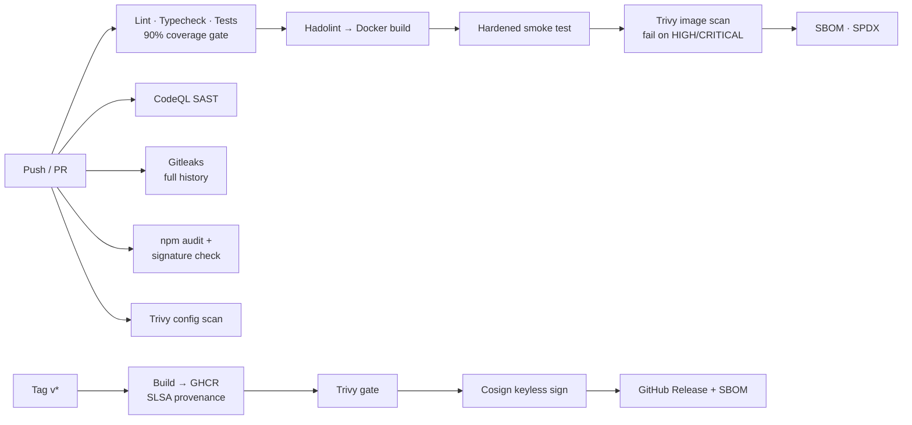

# Secure Audit Log

[](https://github.com/imaadkajee29/secure-audit-log/actions/workflows/ci.yml)
[](https://github.com/imaadkajee29/secure-audit-log/actions/workflows/security.yml)


[](LICENSE)

A **tamper-evident audit logging API** for systems where you need to prove that nobody quietly
changed the record, such as payments, access control or anything regulated. Every event is
cryptographically chained to the one before it, so editing, deleting or reordering a single row
is detected.

It ships with a **DevSecOps pipeline**: SAST, secret scanning, dependency and container
scanning, SBOM generation, and signed, attested release images.

> Built from real problems I work on in enterprise banking integrations: audit-log requirements,
> token-based authentication and proving data integrity to auditors.

---

## Why this exists

Most audit logs are ordinary database tables. Anyone with write access, whether an insider, a
compromised service or a buggy migration, can change history and nobody will ever know.

This service makes tampering **detectable**:

| Attack                       | How it's caught                                       |
| ---------------------------- | ----------------------------------------------------- |
| Edit a field in an old event | Event HMAC no longer matches its content              |
| Delete an event              | Gap in the sequence numbers                           |
| Insert or reorder events     | `prevHash` link breaks                                |
| Rewrite the whole chain      | Needs the HMAC key, which never lives in the database |
| Truncate the tail            | Compare `headHash` with a value anchored externally   |

## How the chain works



1. Each event is serialized to **canonical JSON** (keys sorted recursively), so the same logical
   event always produces the same bytes.
2. Its hash is `HMAC-SHA256(AUDIT_HMAC_KEY, canonical(event + prevHash))`.
3. `GET /v1/verify` streams the chain and recomputes every link in constant memory, using a
   timing-safe comparison.

Defence in depth: SQLite **triggers block `UPDATE` and `DELETE`**, so the table is append-only
even for direct database access. The hash chain catches anyone who bypasses that.

## Architecture



| Layer     | Choice                                | Why                                                       |
| --------- | ------------------------------------- | --------------------------------------------------------- |
| Runtime   | Node 22, TypeScript (`strict`)        | Type safety, built-in `node:sqlite`, so no native deps    |
| HTTP      | Fastify 5 + TypeBox schemas           | Fast, schema-validated input, auto-generated OpenAPI      |
| Auth      | `jose` JWT, algorithm pinned to HS256 | Blocks `alg=none` and algorithm-confusion attacks         |
| Storage   | SQLite (WAL) with `STRICT` tables     | Zero-ops, ACID, `BEGIN IMMEDIATE` serializes chain writes |
| Container | Distroless, UID 65532                 | No shell or package manager, so a minimal attack surface  |

## Quick start

**Requirements:** Node 22.13+ (or Docker).

```bash
git clone https://github.com/imaadkajee29/secure-audit-log.git
cd secure-audit-log
npm ci
cp .env.example .env
# Generate real secrets. The app refuses to start with the placeholders:
node -e "console.log('JWT_SECRET='+require('crypto').randomBytes(48).toString('base64url'))" >> .env
node -e "console.log('AUDIT_HMAC_KEY='+require('crypto').randomBytes(48).toString('base64url'))" >> .env
npm run dev
```

Open the interactive API docs at **http://localhost:3000/docs**.

**With Docker** (production-like: read-only root FS, all capabilities dropped):

```bash
docker compose up --build
```

### Try it

```bash
TOKEN=$(node --env-file=.env --import tsx scripts/mint-token.ts --sub payments-svc --roles writer,auditor)

# Write an event (the actor comes from the token, never the request body)
curl -s -X POST localhost:3000/v1/events \
  -H "Authorization: Bearer $TOKEN" -H 'Content-Type: application/json' \
  -d '{"action":"payment.approve","resource":"account/12345","outcome":"success","metadata":{"amount":1500,"currency":"ZAR"}}'

# Verify the whole chain
curl -s localhost:3000/v1/verify -H "Authorization: Bearer $TOKEN"
# {"valid":true,"checked":1,"headSeq":1,"headHash":"fe46a1e3…"}
```

## API

| Method | Path              | Role      | Description                                          |
| ------ | ----------------- | --------- | ---------------------------------------------------- |
| POST   | `/v1/events`      | `writer`  | Append an event                                      |
| GET    | `/v1/events`      | `auditor` | List events (`limit`, `afterSeq`, `actor`, `action`) |
| GET    | `/v1/events/:seq` | `auditor` | Get one event                                        |
| GET    | `/v1/verify`      | `auditor` | Verify the integrity of the entire chain             |
| GET    | `/health`         | none      | Liveness probe (not rate-limited)                    |
| GET    | `/ready`          | none      | Readiness probe: checks the database                 |
| GET    | `/docs`           | none      | Swagger UI (off by default in production)            |

Writers and auditors are **separate roles** (segregation of duties): a service that writes events
can't read the trail, and an auditor can't write to it.

## DevSecOps pipeline



| Practice                        | Where                                                    |
| ------------------------------- | -------------------------------------------------------- |
| Least-privilege workflow tokens | `permissions: contents: read` by default, raised per job |
| No credential persistence       | `persist-credentials: false` on every checkout           |
| Supply-chain hardening          | `npm ci --ignore-scripts`, lockfile, package signatures  |
| Shift-left security             | Findings uploaded as SARIF to the GitHub Security tab    |
| Signed artifacts                | Sigstore cosign via GitHub OIDC; no long-lived keys      |
| Continuous patching             | Weekly scheduled scans + grouped Dependabot updates      |

## Threat model (STRIDE)

| Threat                     | Example                                    | Mitigation                                                               |
| -------------------------- | ------------------------------------------ | ------------------------------------------------------------------------ |
| **S**poofing               | Forged JWT, `alg=none`, wrong audience     | HS256 pinned; `iss`, `aud`, `exp` and `sub` required; tests for each     |
| **T**ampering              | Editing or deleting audit rows             | HMAC hash chain, sequence checks, append-only triggers                   |
| **R**epudiation            | "I never approved that payment"            | Actor bound to the verified token subject; immutable trail               |
| **I**nformation disclosure | Stack traces, tokens in logs               | Generic 5xx bodies, `Authorization` redacted in logs, `no-store` caching |
| **D**enial of service      | Floods, huge payloads                      | Rate limiting, 16 KB body limit, 8 KB metadata cap, bounded page size    |
| **E**levation of privilege | Writer reading the trail; container escape | Role separation; non-root distroless; read-only FS; `cap_drop: ALL`      |

**Known limits, stated plainly:** an attacker who holds _both_ database write access _and_ the
HMAC key can rewrite history. Mitigate by keeping the key in a secret manager, and by periodically
anchoring `headHash` somewhere they don't control (a ticket, a separate system, or a transparency
log). Clients should also be authenticated with short-lived tokens issued by a real identity
provider. `scripts/mint-token.ts` is a dev helper only.

## Testing

```bash
npm test           # 58 tests
npm run coverage   # with coverage thresholds enforced
npm run lint       # ESLint strict-type-checked
```

The tests include **attack simulations**: forged and expired tokens, `alg=none`, role escalation,
log-injection payloads, oversized bodies, and direct database tampering (dropping the triggers and
editing rows) to prove `/verify` catches it.

## Roadmap

This is project 1 of 3 in a connected DevSecOps portfolio:

- [x] **Secure Audit Log**: tamper-evident API + DevSecOps pipeline _(this repo)_
- [ ] **Kubernetes deployment**: Helm chart, NetworkPolicies, Pod Security Standards, secrets
      from an external store, policy-as-code admission
- [ ] **AI security review agent**: an LLM-powered reviewer that comments on PRs with security
      findings, running inside this pipeline

## Author

**Imaad Kajee**, Software Engineer · BCIS Honours (IIE Varsity College)
[LinkedIn](https://www.linkedin.com/in/imaad-kajee-aa557026a/)
